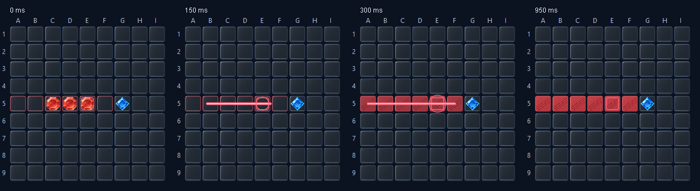

# Color Match Arena 2.2 — Game feel

Đã thực hiện phần code của plan game-feel-v3. Tên sản phẩm giữ tiếng Anh;
giữ tile PNG v2 và BGM `cyberwave-orchestra-puzzle-game-bright-casual-video-game-music-249202.mp3`
đã nhập trước đó. Không tạo thêm art, không thay nhạc hoặc reset cài đặt âm lượng.

## Thay đổi

- Hover ghost ease-out 80 ms; quân được xác nhận pop 180 ms; viền tĩnh đánh dấu nước cuối.
- Pending chỉ giữ một request, không tự đặt quân; timer snapshot không mở khóa pending.
  Server từ chối nước đi qua `MOVE_REJECTED`: mở khóa và hiện lý do inline 3 giây.
- Capture: nguồn fade 120 ms, tia tỏa từ tâm thực do GameRules ghi nhận trong
  80–280 ms, fade tới 430 ms; vùng đổi màu trong 180–400 ms. Không suy tâm từ endpoints.
  Điểm và lượt áp ngay theo snapshot; chỉ phần trình bày chuyển tiếp.
- Accent điểm 250–900 ms, một cue chính mỗi nước. Capture được ưu tiên hơn turn cue;
  turn cue thay move cue khi nước đối thủ chuyển về lượt mình. Không phát lại khi nhận tick/duplicate.
- Reduced motion áp trạng thái cuối và viền tĩnh. Clock bàn tự dừng khi hiệu ứng kết thúc;
  dispose dừng cả timer bàn/score/footer.
- Kết quả dùng final snapshot trước khi mở dialog. `REMATCH_STATUS` gửi readiness thật
  của cả hai người, cập nhật cả dialog đang mở và header đang chờ. Peer rời/từ chối
  đưa người còn lại về sảnh với lý do; không gửi lại reply từ dialog đã bị đóng.
- Mix SFX: capture 1.0, move/win/lose .85, challenge .80, click/turn .45, chat/tick .30
  nhân với volume đã lưu. Capture duck nhạc nhẹ 450 ms; chat/tick nhường cue quan trọng;
  cue trễ quá 500 ms bị bỏ để tránh phát dồn sau khi mixer tải.

## Kiểm tra

Lệnh: `powershell -NoProfile -ExecutionPolicy Bypass -File scripts/Test.ps1 -Screenshots`.

- Rules: 4 hướng, blocker, tâm tia bất đối xứng, ô không hợp lệ, lãnh thổ dưới quân,
  thứ tự capture giữ nguyên; tutorial khớp GameRules.
- Room thật với session trong bộ nhớ: hai người, spectator vào muộn, capture, timer,
  reject, readiness broadcast, spectator không accept được, cả hai accept tạo match mới,
  decline tách người chơi/spectator. Fixture bỏ riêng bước lưu DB.
- TCP ObjectStreams thật trên loopback: metadata, EDT, reject qua đúng handler,
  final score trước dialog, reply/readiness đấu lại, peer đóng kết nối, protocol mismatch.
- PNG: đủ 10 asset alpha, kiểm tra màu phe và sheet 32/48/64 px; 10 WAV decode được.
- Presentation: chặn double submit, giữ pending qua tick, retry sau reject, timeline
  với clock điều khiển được, hai đầu tia đi từ đúng tâm, clock dừng, reduced motion,
  cue hierarchy và readiness trên panel kết quả. Không sửa preference để chạy fixture.
- Benchmark offscreen 120 lần paint được in ra khi chạy; đây không phải FPS trên máy chơi.
  Lần kiểm tra cuối: **7.54 ms/paint** trong repo, **6.93 ms/paint** với classpath JAR.
- Chạy lại AssetChecks/PresentationChecks từ thư mục TEMP riêng, chỉ dùng tests + JAR:
  đủ PNG/WAV và kiểm tra presentation đều PASS, không dựa vào thư mục assets trong repo.
- ZIP đã kiểm tra chứa đúng JAR vừa build, cùng launcher và hướng dẫn 2.2.
  SHA256 ZIP: `3EBC772C588B46B5C3B22EAE3910094B1E7E9D3EA46F9752532399BBA461AEE1`.

Ảnh là Swing render thực từ fixture, không phải concept:

## Chạy và bàn giao

`Chay_Server.bat` / `Chay_Client.bat` trong repo tự build. Client gửi sang máy khác:
`dist/ColorMatchArena-Client.zip`; giải nén và chạy `Chay_Game.bat`, cần JDK 24.

**Restart cả server và mọi client bằng bản 2.2.** Protocol 3 thay serialized capture data
và thêm readiness; không dùng lẫn bản 2.1. Không cần import lại database.

Chưa xác nhận bằng thiết bị thật: nghe cả trận trên loa/tai nghe, LAN hai laptop,
DPI 125/150% và cảm nhận latency khi chơi. Test không xác nhận MySQL authentication
hoặc lưu kết quả vào DB thật. Không thay hoặc dừng server đang chạy trong phiên người dùng.
